<div align="center">

# WebCloner

### Clone any website into a clean Next.js codebase, with one command

**by [Reivan Elsyafir Pratama](https://www.x2zu.net/)**

`/webclone` · `/webclone-full` · `/webclone-recon` · `/webclone-audit` · `/webclone-brand` · `/webclone-remix`

</div>

---

WebCloner is a Claude Code plugin that turns a live website into editable Next.js 16 + Tailwind v4 + shadcn/ui code. It does not guess: it measures the real fonts, images, colors, and motion timings of the source, rebuilds the page, and refuses to call the job done until the clone passes a measured pixel-fidelity gate.

- **One command, any folder.** No template repo to clone; the project is created for you.
- **Zero browser setup.** Uses the Chrome or Edge you already have.
- **Measured, not eyeballed.** Exact colors, self-hosted real fonts, harvested images, real easing curves and scroll settings.
- **Whole sites, not just pages.** Every route cloned and gated at 90-100% fidelity on desktop, tablet, and mobile.
- **Make it yours.** Extract a brand kit, then remix a clone into your own brand.

## Showcase

Every score below is measured, not estimated: source and clone are captured at the same viewport and scroll position and compared with `visual-diff.mjs`.

### TaskGo: full Webflow site, every route

A `/webclone-full` clone of the [TaskGo Webflow template](https://taskgo-oly.webflow.io/): all 6 routes rebuilt as Next.js components, with the site's GSAP interactions (split-letter headings, scroll-scrubbed cards) and Webflow IX2 interactions (scroll reveals, logo marquee, FAQ accordion, pricing tabs, mobile menu) replayed from their exported data.

| Route | 1440px | 768px | 390px | Page height |
|---|---|---|---|---|
| `/` | 97.91% | 98.98% | 98.42% | identical |
| `/style-guide` | 99.68% | 99.43% | 99.02% | identical |
| `/license` | 99.38% | 99.04% | 97.97% | identical |
| `/changelog` | 99.57% | 99.35% | 98.74% | identical |
| `/401` | 99.54% | 99.34% | 98.75% | identical |
| `/404` | 99.61% | 99.47% | 98.89% | identical |

<sub>Full-page pixel fidelity from `fidelity-gate.mjs` (gate: ≥ 90%, height drift ≤ 3%). 6/6 routes pass.</sub>

<table>
  <tr>
    <th width="50%">Original</th>
    <th width="50%">WebCloner clone</th>
  </tr>
  <tr>
    <td>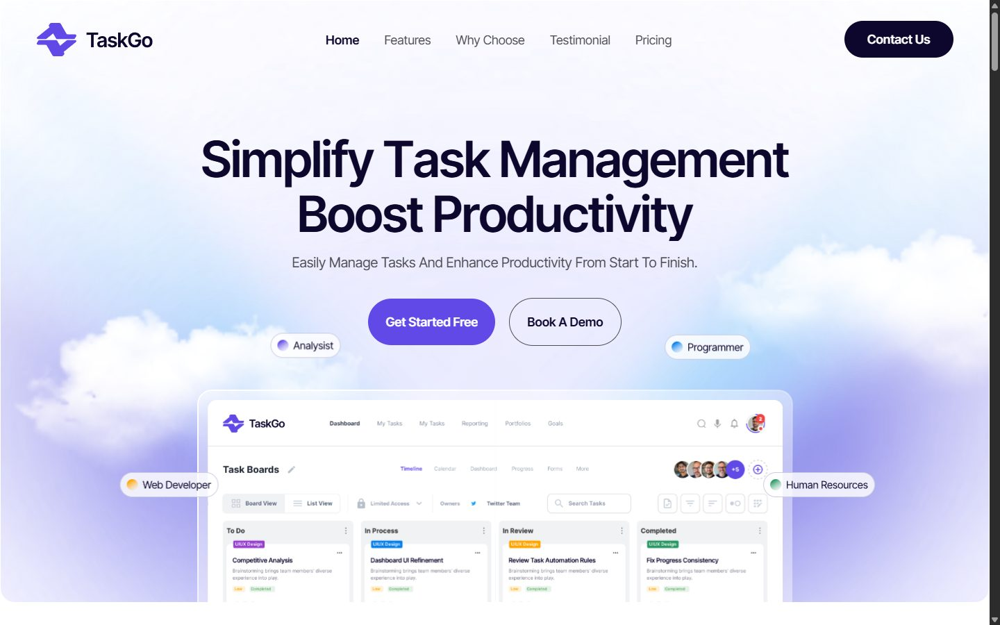</td>
    <td>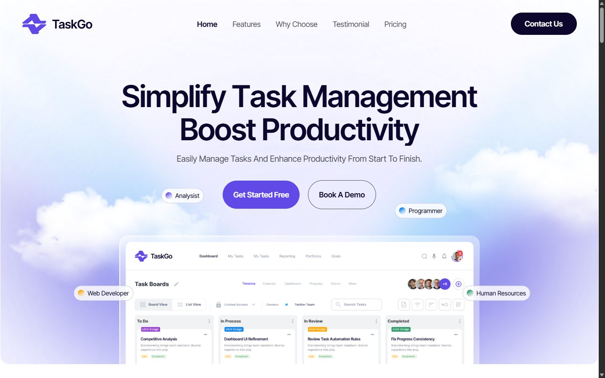</td>
  </tr>
  <tr><td colspan="2" align="center"><sub>Hero · 1440px · <b>99.48%</b></sub></td></tr>
  <tr>
    <td>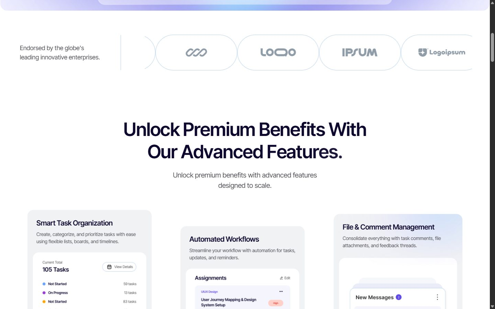</td>
    <td>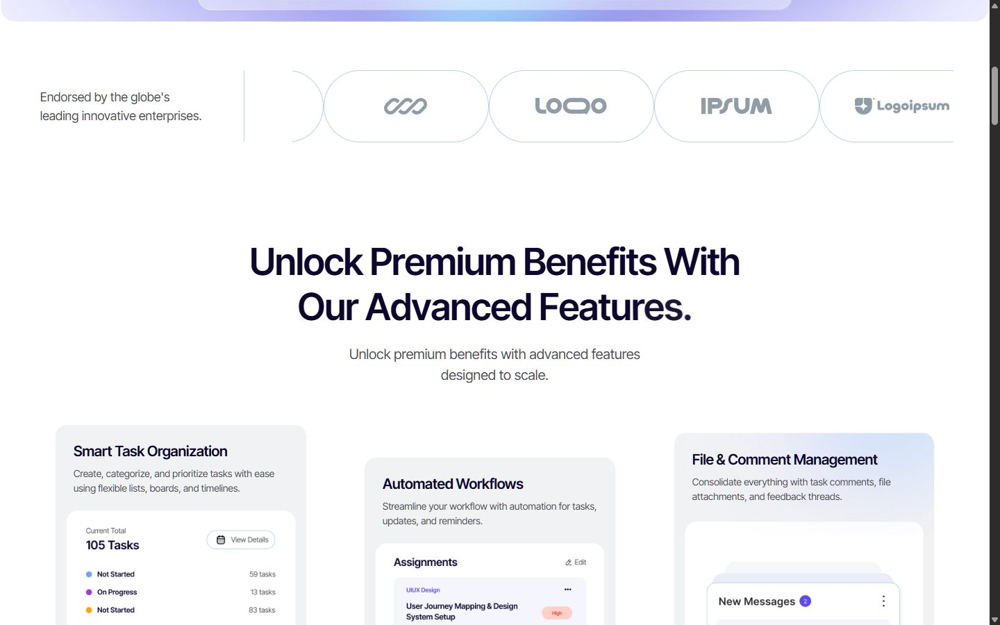</td>
  </tr>
  <tr><td colspan="2" align="center"><sub>Logo marquee + features · <b>97.99%</b></sub></td></tr>
  <tr>
    <td>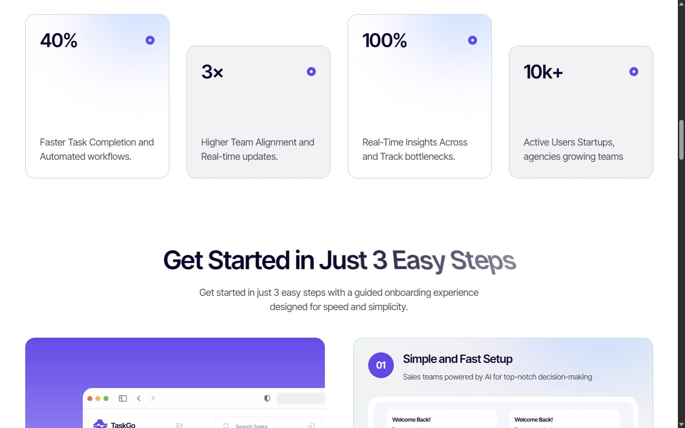</td>
    <td></td>
  </tr>
  <tr><td colspan="2" align="center"><sub>Stats + scroll-scrubbed split-letter heading, caught mid-animation on both · <b>98.93%</b></sub></td></tr>
  <tr>
    <td>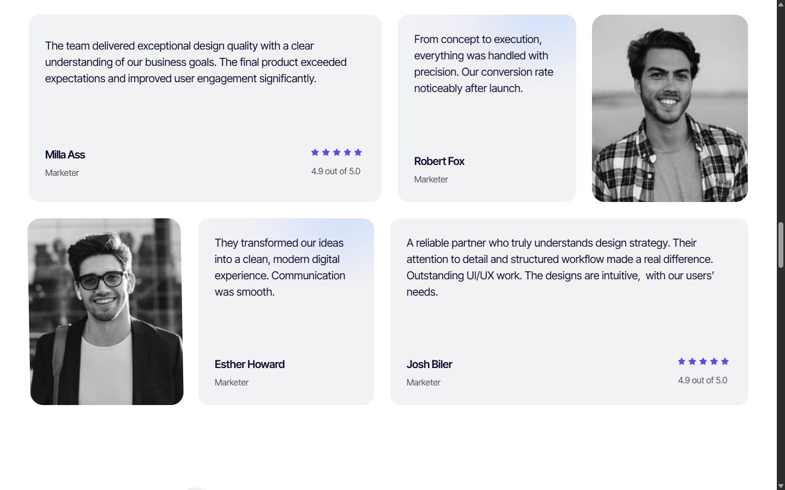</td>
    <td>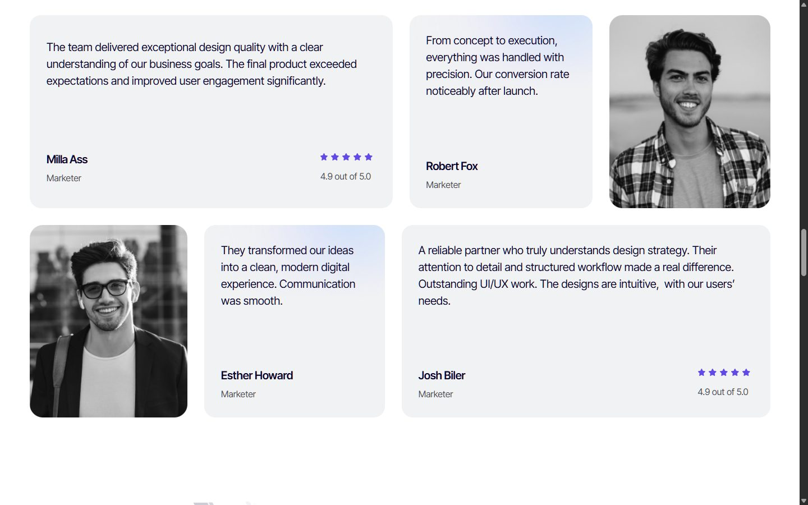</td>
  </tr>
  <tr><td colspan="2" align="center"><sub>Testimonials · <b>97.89%</b></sub></td></tr>
  <tr>
    <td>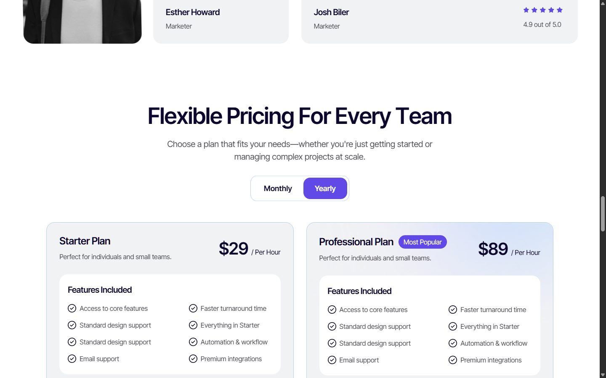</td>
    <td>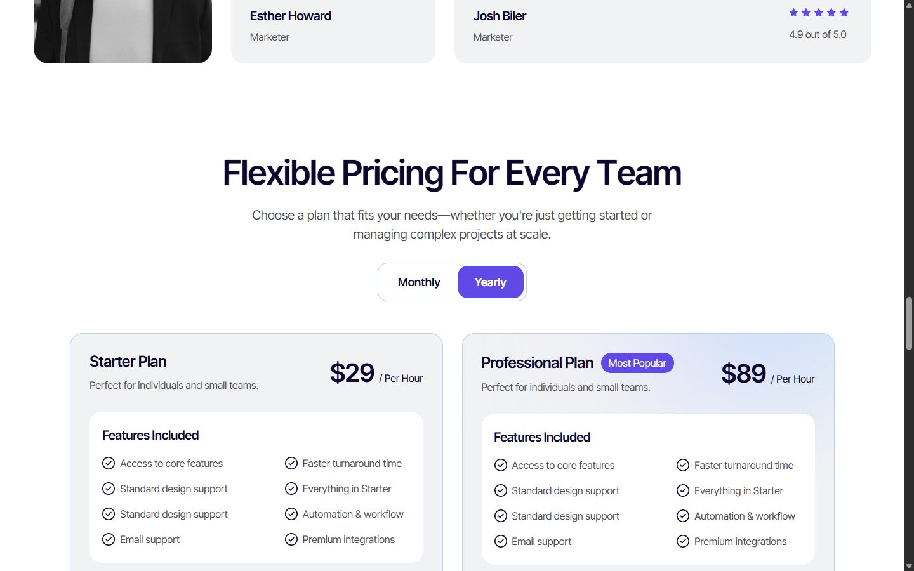</td>
  </tr>
  <tr><td colspan="2" align="center"><sub>Interaction: pricing toggle after a real click on "Yearly"</sub></td></tr>
  <tr>
    <td align="center">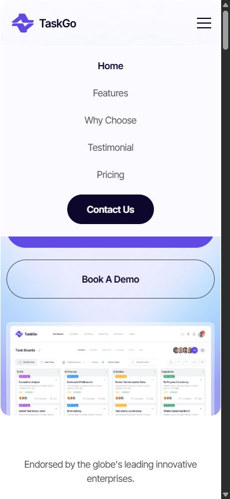</td>
    <td align="center">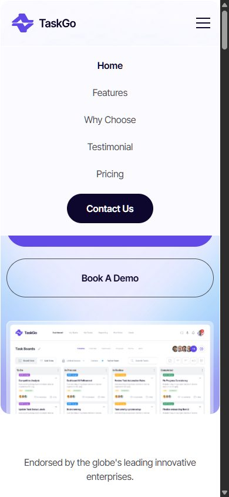</td>
  </tr>
  <tr><td colspan="2" align="center"><sub>Interaction: mobile menu opened with a real tap · 390px · <b>99.30%</b></sub></td></tr>
</table>

<sub>Demo clone for illustration only. The TaskGo template, its design, and its images belong to Olynex and the respective asset owners.</sub>

### poliwangi.ac.id

A WebCloner clone of [poliwangi.ac.id](https://poliwangi.ac.id/), rebuilt as real Next.js components (hero slider, sections, header, footer, accessibility widget), next to the live site.

<table>
  <tr>
    <th width="50%">Original</th>
    <th width="50%">WebCloner clone</th>
  </tr>
  <tr>
    <td>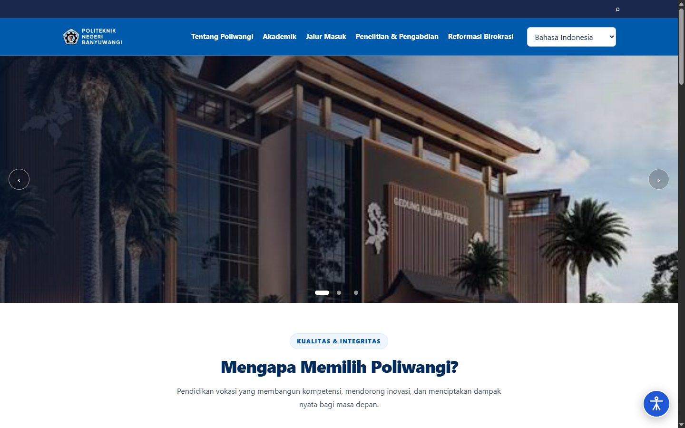</td>
    <td></td>
  </tr>
  <tr><td colspan="2" align="center"><sub>Hero · 1440px · <b>100%</b> pixel fidelity</sub></td></tr>
  <tr>
    <td>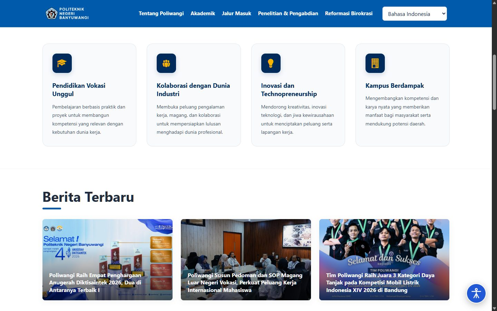</td>
    <td></td>
  </tr>
  <tr><td colspan="2" align="center"><sub>Feature cards + news · 1440px · <b>99.34%</b></sub></td></tr>
  <tr>
    <td>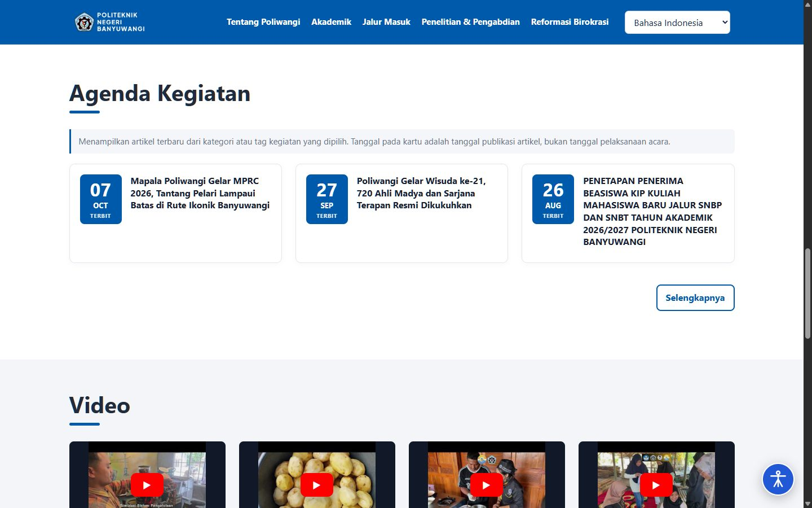</td>
    <td></td>
  </tr>
  <tr><td colspan="2" align="center"><sub>Agenda + video · 1440px · <b>100%</b></sub></td></tr>
  <tr>
    <td align="center"></td>
    <td align="center">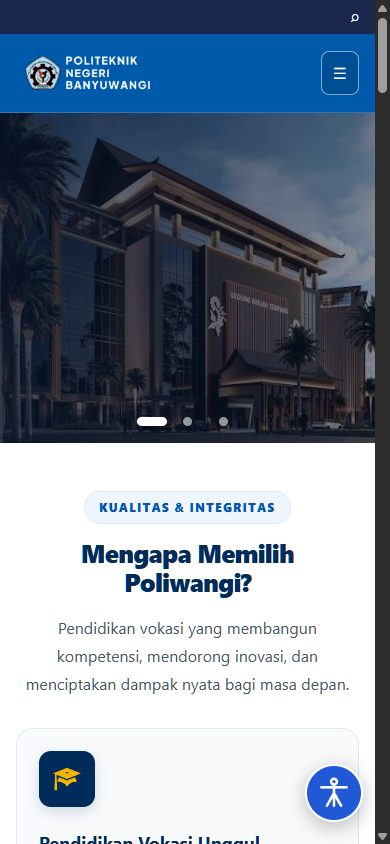</td>
  </tr>
  <tr><td colspan="2" align="center"><sub>Mobile · 390px · <b>99.98%</b> · full page height identical at both widths (4851px / 9143px)</sub></td></tr>
</table>

<sub>Demo clone for illustration only. The Politeknik Negeri Banyuwangi name, logo, photos, and content belong to their owner.</sub>

## Install

In Claude Code:

```text
/plugin marketplace add x4zu/WebCloner
/plugin install webclone@webcloner
```

Restart Claude Code (or run `/reload-plugins`). Update later with `/plugin marketplace update webcloner`.

## Commands

| Command | What it does |
|---|---|
| `/webclone <url1> [<url2> ...]` | Clone one or more pages into a Next.js app with fidelity gates (fonts, images, colors, scroll feel) |
| `/webclone-full <url> [--pages N] [--min 90]` | Clone the **whole site**, every route, and iterate until each route hits 90-100% pixel fidelity at 1440/768/390 |
| `/webclone-recon <url>` | Inspect only: screenshots, assets, routes, interactions, motion, APIs, complexity grade (L1-L6), recommended mode |
| `/webclone-audit [url] [--fix]` | Score an existing clone: per-route pixel diff, coverage, strict font/image/color checks, ranked fix list |
| `/webclone-brand <url>` | Extract a brand kit: logos, 7 color roles, fonts, imagery, voice, `DESIGN.md`, `design-dna.json`, Tailwind `theme.css`, `brand-kit.html` |
| `/webclone-remix [brief]` | Make a clone your own: keep layout and motion, replace brand, copy, media, colors, and fonts; audit for leftovers |

Typical flows:

```text
/webclone-recon stripe.com          # how hard is it?
/webclone stripe.com                # clone the home page
/webclone-audit --fix               # push fidelity up
/webclone-full linear.app --min 95  # the whole site, 95% per route
/webclone-brand mybrand.com         # my own brand kit
/webclone-remix docs/brand/mybrand-com/brand.json
```

## How it works

1. **Set up**: `scaffold.mjs` creates `./<site>-clone/` from the bundled template and installs dependencies (or reuses the current clone).
2. **Real source first**: looks for the site's public repository and checks its license before scraping.
3. **Recon**: drives your installed Chrome/Edge over the DevTools protocol (no Playwright download needed) to capture screenshots at three widths, computed palette, `@font-face` sources, every loaded asset (with real formats sniffed), routes, interaction states, API responses, and motion values (`getAnimations()`, GSAP/ScrollTrigger, Lenis).
4. **Assess**: complexity L1-L6 and mode (faithful / visual / remix / teardown).
5. **Build**: self-hosted real fonts, harvested images, exact colors, measured motion.
6. **Gate**: pixel diff per width (`fidelityPct`, height drift), `compare-recon`, and `audit-clone --strict` (fails on system-font stand-ins, missing images, or eyeballed colors), then `npm run check`.

## Requirements

- [Claude Code](https://code.claude.com/docs)
- [Node.js](https://nodejs.org/) 20.9+ (24 recommended)
- Google Chrome, Microsoft Edge, or Chromium installed. Or set `WEBCLONE_BROWSER_PATH`, or add Playwright to the project (`npm i -D playwright && npx playwright install chromium`).
- Optional: a browser MCP (Playwright MCP, Chrome DevTools MCP, Claude in Chrome) for hover/click states.

## Scripts

All in `skills/webclone/scripts/`; each prints usage with `--help` and works on its own.

| Script | Purpose |
|---|---|
| `scaffold.mjs` | Create/reuse the Next.js clone project |
| `recon-site.mjs` | Screenshots 1440/768/390 + page facts (palette, fonts, frameworks, motion signals) |
| `asset-harvest.mjs` | Download every image/font/media the page uses; self-hosted `fonts.css`; URL -> local map |
| `motion-probe.mjs` | Measured animations, transitions, GSAP timelines, ScrollTriggers, Lenis options |
| `interaction-probe.mjs` | Hover/click/scroll/canvas-drag states with screenshots |
| `route-crawl.mjs` | Same-site route map with per-route screenshots |
| `network-capture.mjs` | XHR/fetch responses as fixtures for SPAs |
| `sourcemap-hunt.mjs` | Find and save source maps |
| `mirror-site.mjs` | 1:1 mirror of static-built sites (Astro/Vite SSG/Hugo) |
| `visual-diff.mjs` | Pixel diff, `fidelityPct`, height drift, `--min-fidelity` gate |
| `fidelity-gate.mjs` | Per-route, per-width gate across a whole site -> `FIDELITY.md` |
| `compare-recon.mjs` | Source vs clone report (`CLONE_REPORT.md`) |
| `audit-clone.mjs` | Fidelity gates + tracking/brand/TODO/external-link scan (`CLONE_AUDIT.md`) |
| `dna-scaffold.mjs` | `design-dna.json` skeleton from recon |
| `brand-kit.mjs` | `brand.json` -> `brand-kit.html` + Tailwind `theme.css`, with validation |

## Repository layout

```
.claude-plugin/          marketplace "webcloner", plugin "webclone"
skills/
  webclone/              main skill: SKILL.md, references/, scripts/, template/ (Next.js scaffold)
  webclone-full/         whole-site clone with per-route gate
  webclone-recon/        inspect only
  webclone-audit/        score and fix a clone
  webclone-brand/        brand kit extraction
  webclone-remix/        make it yours; craft rules, frontend-design, starter themes
LICENSES/                third-party license texts
THIRD_PARTY_NOTICES.md   what came from where
```

## Develop

```bash
git clone https://github.com/x4zu/WebCloner.git
claude --plugin-dir ./WebCloner      # load the plugin from disk
claude plugin validate ./WebCloner

cd WebCloner/skills/webclone/template
npm ci && npm run check              # the scaffold must stay green
```

## Responsible use

For sites you own or may reproduce: migrations, recovering lost source, learning how production sites are built, and as a starting point you then make your own with `/webclone-remix`. Do **not** use it for phishing, impersonation, or passing off someone else's design or brand as yours, and respect each site's terms of service. Logos, brand assets, fonts, media, and copy belong to their owners. The tools never bypass CAPTCHAs or anti-bot walls.

## Author

Designed, combined, and maintained by **[Reivan Elsyafir Pratama](https://www.x2zu.net/)**.

## License

[MIT](LICENSE)

<sub>Acknowledgements: WebCloner combines and extends open-source work by JCodesMore (ai-website-cloner-template), Jane / @xiaoerzhan and nexu-io (open-design), Anthropic (skills), Emil Kowalski, GreenSock, and Matthew Blode. See [THIRD_PARTY_NOTICES.md](THIRD_PARTY_NOTICES.md) for details and licenses.</sub>
